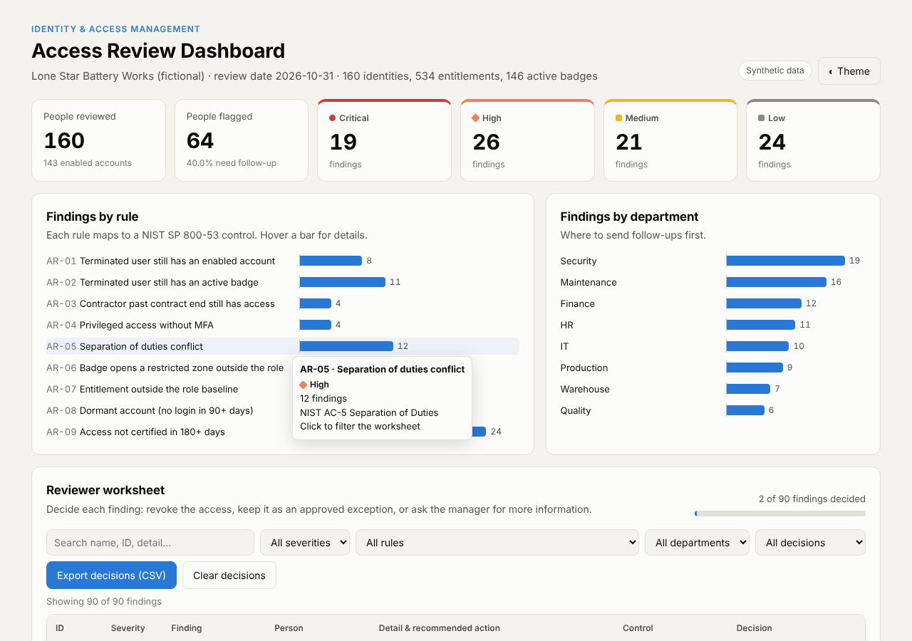

# IAM Access Review Dashboard

[](https://github.com/Guavasorbet/iam-access-review/actions/workflows/tests.yml)

An automated **user and badge access review** for a fictional battery factory. A Python
engine joins HR, directory, entitlement and physical badge data, flags risky access
with nine rules mapped to **NIST SP 800-53** controls, and publishes the results to a
dashboard where a reviewer decides each finding.

**Live demo:** https://guavasorbet.github.io/iam-access-review/



## Why this matters

Most access problems are not hacks. They're people who left and still have a working
badge, contractors whose access outlived their contract, or admins without MFA.
Companies catch these through periodic **access reviews** (also called user access
certifications). This project automates the tedious part, finding the problems, so the
reviewer can spend their time on decisions.

It covers both **logical access** (accounts, entitlements, MFA) and **physical access**
(badges and restricted zones), because in a factory both protect people and equipment.

## What it checks

| Rule | Finding | Severity | NIST SP 800-53 |
| --- | --- | --- | --- |
| AR-01 | Terminated user still has an enabled account | Critical | AC-2(3) Disable Accounts |
| AR-02 | Terminated user still has an active badge | Critical | PE-2 Physical Access Authorizations |
| AR-03 | Contractor past contract end still has access | High | AC-2(2) Temporary Account Management |
| AR-04 | Privileged access without MFA | High | IA-2(1) MFA for Privileged Accounts |
| AR-05 | Separation of duties conflict | High | AC-5 Separation of Duties |
| AR-06 | Badge opens a restricted zone outside the role | High | PE-3 Physical Access Control |
| AR-07 | Entitlement outside the role baseline | Medium | AC-6 Least Privilege |
| AR-08 | Dormant account (no login in 90+ days) | Medium | AC-2(3) Disable Accounts |
| AR-09 | Access not certified in 180+ days | Low | AC-2 Account Management |

Role baselines, privileged entitlements, restricted zones and separation-of-duties
pairs are defined in [`data/policy.json`](data/policy.json), so the rules can be tuned
without changing code.

## Dashboard features

- Totals by severity and the share of people needing follow-up
- Findings by rule and by department; click a bar to filter the worksheet
- Reviewer worksheet: search and filter, then mark each finding **Revoke**,
  **Keep (exception)** or **Needs info** with a note
- Progress bar for the review, saved in the browser
- **Export decisions to CSV** as audit evidence
- Light and dark mode; works on a phone

## How it works

```
data/generate_data.py   →  hr_roster.csv, directory_accounts.csv,
                           entitlements.csv, badge_access.csv
                                   │
review/run_review.py    →  joins on user_id, applies review/rules.py
                                   │
            ┌──────────────────────┼───────────────────────┐
   reports/findings.csv     reports/summary.md      docs/findings.js
     (audit export)          (written summary)       (dashboard data)
```

## Run it yourself

Requires Python 3.10+ and nothing else (standard library only).

```bash
git clone https://github.com/Guavasorbet/iam-access-review.git
cd iam-access-review
python data/generate_data.py          # create fresh sample data (try --seed 7)
python review/run_review.py           # run the review
python -m unittest discover tests     # run the tests
```

Then open `docs/index.html` in a browser.

## Project structure

```
data/      policy.json, sample data and the data generator
review/    rules.py (the nine rules) and run_review.py (the pipeline)
reports/   findings.csv and summary.md from the latest run
docs/      the dashboard (served by GitHub Pages)
tests/     unit tests for every rule
```

## Skills shown

Identity lifecycle (joiner, mover, leaver) · least privilege · separation of duties ·
MFA enforcement · physical access control · NIST SP 800-53 · Python · data joins
and validation · unit testing · JavaScript dashboard · audit evidence

## Data notice

Every person, account and badge here is fictional and generated by
`data/generate_data.py`. "Lone Star Battery Works" is a made-up company.

## Author

Miguel Morales · [LinkedIn](https://www.linkedin.com/in/miguelmoralesr2d2) · [GitHub](https://github.com/Guavasorbet)
